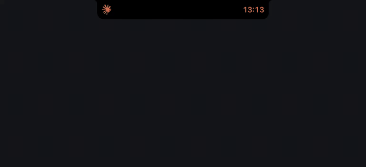
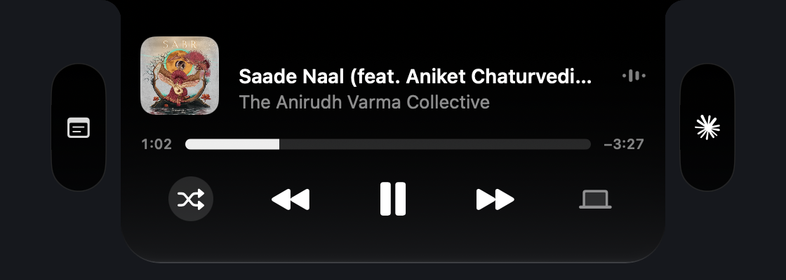
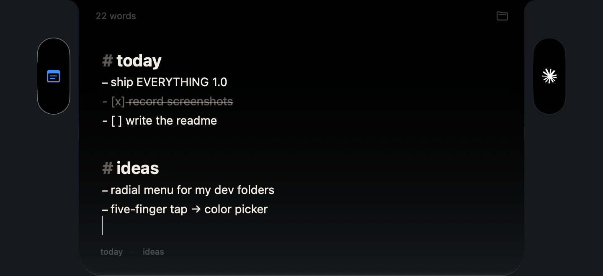
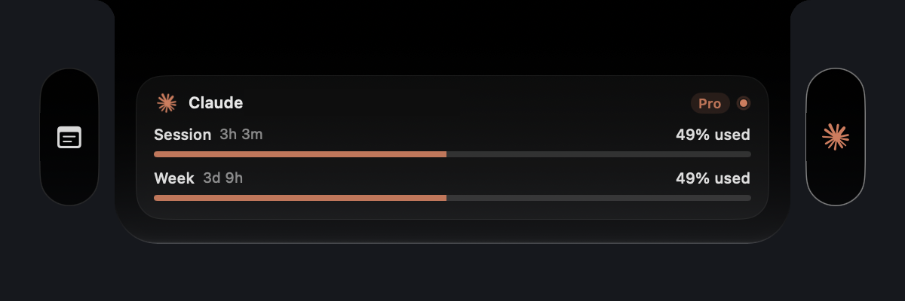
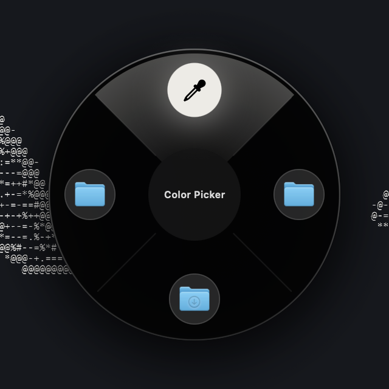
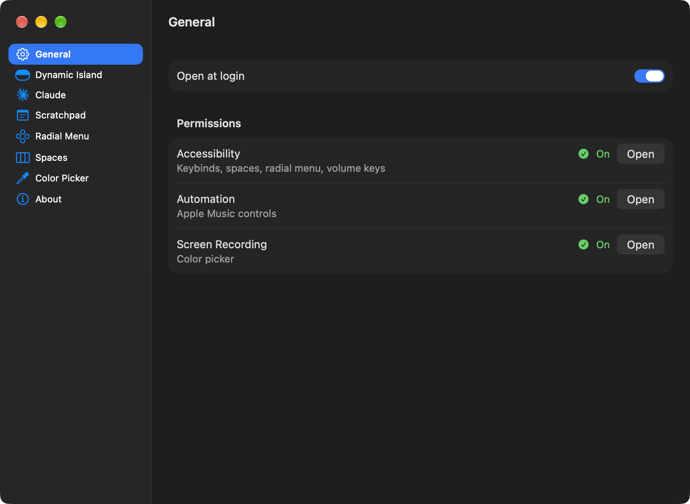
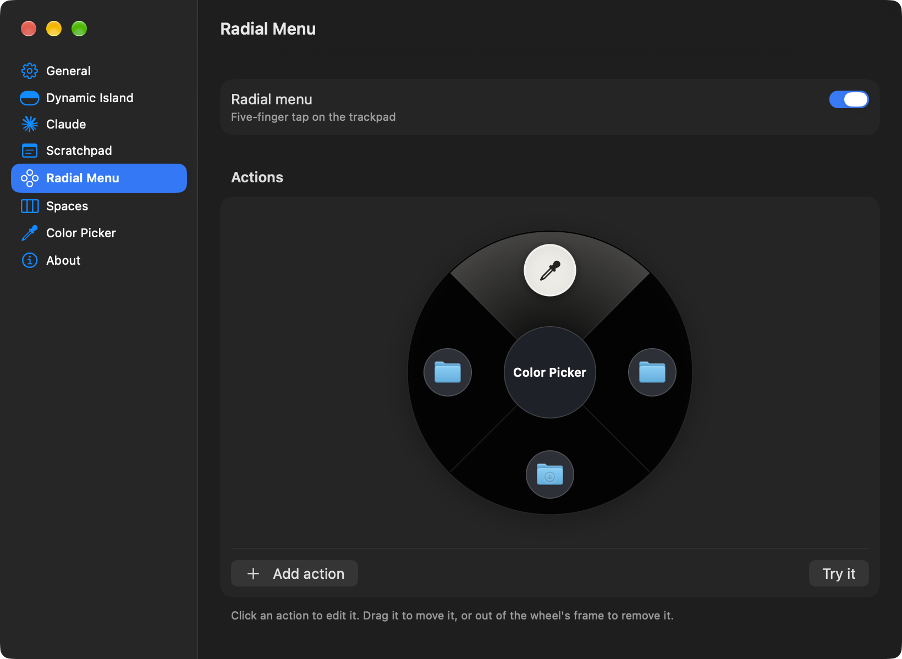

<h1 align="center">EVERYTHING (mac app)</h1>

  dynamic island <code>&&</code> scratchpad <code>&&</code> radial menu <code>&&</code> claude usage <code>&&</code> instant spaces switcher

  

  <a href="https://github.com/shvm-mane/everything/releases/latest"><b>DOWNLOAD :)</b></a>

i used to run three apps together:
- [vorssaint](https://github.com/vorssaint/vorssaint-utils) - all-in-one utility app
- [wisp](https://github.com/sulemaanhamza/wisp) - simple, clean scratchpad
- [instantspaceswitcher](https://github.com/jurplel/InstantSpaceSwitcher) - self explanatory

heres the thing - my mac only has 8GB RAM 🥲 so memory footprint and CPU usage matters to me, and since all three are open source i merged em into one app (w/ some tweaks ofc).

## what it does

### 1. dynamic island

- apple music player
- volume, brightness, battery indicators
- song changes show up around the notch
- two pills float beside the open island - scratchpad & claude

> i wasnt satisfied w/ `atoll`, `boringnotch`, etc. so heres yet another dynamic island app...

### 2. scratchpad

- a markdown scratchpad that lives in the island (tweaked [wisp](https://github.com/sulemaanhamza/wisp) under the hood)
- headings, lists, checkboxes, history, saved notes
- open it with `⌥ space` from anywhere

### 3. claude usage

- your session and weekly limits, read straight from claude code on your mac
- while claude code is working, a lil spinner and timer sit next to the notch
- you get a notice when it's done. no sign-in, no api key

### 4. radial menu

- tap the trackpad with five fingers and a wheel opens at your pointer
- files, folders, websites (it grabs their icons), the color picker, and submenus

### 5. instant spaces

- default MacOS spaces switching is so damn slow, make it instant w/ keybinds or the normal trackpad swipe
- [instantspaceswitcher](https://github.com/jurplel/InstantSpaceSwitcher) is used here

### 6. color picker

- click any pixel on screen and its color is copied as HEX, RGB, HSL or SwiftUI.

### 7. misc

- opening a `.dmg` offers to install the app inside and eject it

## install

1. download `EVERYTHING.dmg` from [releases](https://github.com/shvm-mane/everything/releases/latest).
2. drag EVERYTHING into applications.
3. the app isn't notarized (that needs a paid apple developer account), so MacOS will complain the
   first time. right-click EVERYTHING in applications → **open**.
4. settings opens on first launch. grant what you want to use; each permission says what it's for.

right-click the island to open settings.

**needs:** macos 14 or newer. the island is built for macs with a notch.

## permissions

| permission | why |
|---|---|
| accessibility | keybinds, instant spaces, the radial menu's tap, the volume keys |
| automation (music) | controlling apple music from the island |
| screen recording | the color picker's magnifier |

everything runs locally.
the only network request it makes is fetching a website's icon when you add a link to the radial menu,
and that goes to the website itself.

## settings

  
  

## credits

EVERYTHING is a fork of, and wouldn't exist without:

- **[vorssaint](https://github.com/vorssaint/vorssaint-utils)** by vorssaint (gpl-3.0): the dynamic island, radial menu, color picker and most of the app.
- **[wisp](https://github.com/sulemaanhamza/wisp)** by sulemaan hamza (mit): the scratchpad editor. license in `Sources/Everything/Scratchpad/Wisp/LICENSE-wisp.txt`.
- **[instantspaceswitcher](https://github.com/jurplel/InstantSpaceSwitcher)** by jurplel (mit): instant space switching. license in `Sources/ISS/LICENSE-InstantSpaceSwitcher.txt`.

go star them.

## license

because it's built on `vorssaint`, `EVERYTHING` is [gpl-3.0](LICENSE)
